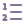
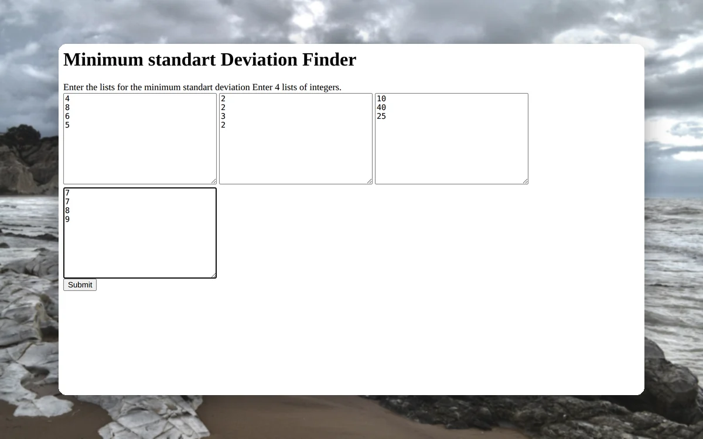
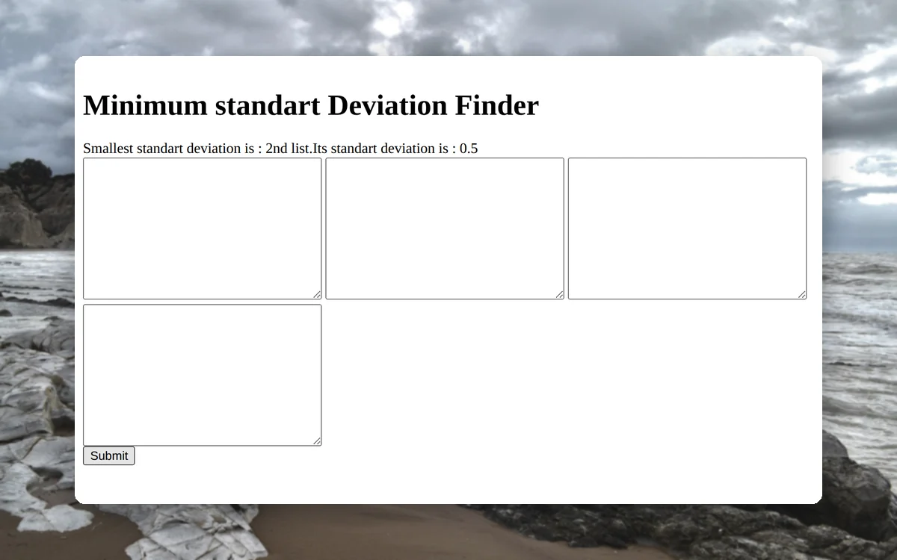
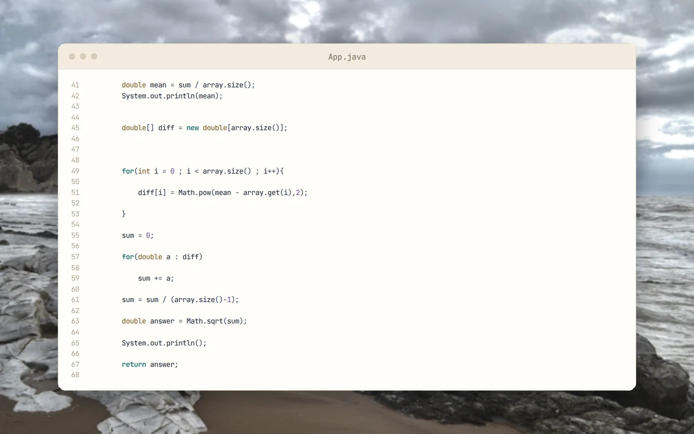

<p align="center">
  <picture>
    <source media="(prefers-color-scheme: dark)" srcset="docs/brand/svg/smallest-sd-finder-logo-on-dark.svg">
    
  </picture>
</p>

<h1 align="center">Compare four lists. Find the steadiest one.</h1>

<p align="center">
  Archived Java coursework from 2019 and 2020, built around Travis CI and Heroku deployment.<br>
  <b>A Spark web app. Four integer lists in, the smallest standard deviation out.</b>
</p>

<p align="center">
  
  
  
  
  <a href="https://github.com/mertkayacs/Smallest-Standart-Deviation-Finder"></a>
</p>

<p align="center">
  <a href="#quick-start"></a>
  <a href="src/main/java/com/mycompany/app/App.java"></a>
  <a href="https://mertkayacs.com/?utm_source=github&utm_medium=readme&utm_campaign=Smallest-Standart-Deviation-Finder-repo&utm_content=portfolio-badge"></a>
</p>

Smallest Standard Deviation Finder is a small Java web app built with Spark and Mustache. A page with four text boxes takes four lists of integers and reports which list has the smallest standard deviation, together with its value. It began as an exercise in continuous integration and deployment, with a Travis CI configuration and a Procfile for Heroku. The Heroku demo no longer responds (HTTP 404 on 7 November 2026), so run the app locally.

---

## Why Smallest Standard Deviation Finder

The project is one page and one calculation, and both are easy to read.

|  |  |
|---|---|
|  **Four lists, one answer** | Type one integer per line into each of the four boxes. The page names the list with the smallest spread and prints its standard deviation. |
|  **Sample standard deviation** | The calculation in [App.java](src/main/java/com/mycompany/app/App.java) divides by n minus 1. An empty list receives a sentinel score of 999. |
|  **Builds to one runnable jar** | `mvn package` runs the assembly plugin and writes a single jar with its dependencies. The Procfile holds the original Heroku start command. |

## A quick tour

<table>
  <tr>
    <td width="50%" valign="top">
      <picture>
        <source media="(prefers-color-scheme: dark)" srcset="docs/assets/readme/tour/form-dark.webp">
        
      </picture>
      <h3>Four lists in</h3>
      The page at /compute has four text boxes. Here each holds a list of integers, one per line.
    </td>
    <td width="50%" valign="top">
      <picture>
        <source media="(prefers-color-scheme: dark)" srcset="docs/assets/readme/tour/result-dark.webp">
        
      </picture>
      <h3>Steadiest list</h3>
      Submitting the form names the list with the smallest standard deviation and prints its value, here 0.5 for the second list.
    </td>
  </tr>
  <tr>
    <td width="50%" valign="top">
      <picture>
        <source media="(prefers-color-scheme: dark)" srcset="docs/assets/readme/tour/empty-dark.webp">
        
      </picture>
      <h3>Empty list</h3>
      An empty list gets the sentinel score 999, so here the first list wins.
    </td>
    <td width="50%" valign="top">
      <picture>
        <source media="(prefers-color-scheme: dark)" srcset="docs/assets/readme/tour/code-dark.webp">
        
      </picture>
      <h3>Standard deviation</h3>
      The mean, the squared differences and the square root of their sum divided by n minus 1, as written in App.java.
    </td>
  </tr>
</table>

<p align="center"><sub>The page captures come from the Spark app running locally in Chromium. The code card shows App.java as it is in the repository.</sub></p>

## Features

**Web app**

- A form at /compute with four text areas.
- The port comes from the PORT environment variable and defaults to 4567.
- Spark Java 2.7.2 with Mustache templates.

**Calculation**

- Reports the first list with the smallest standard deviation, or says that all four are equal.
- Prints the value next to the list position.

**Project files**

- Maven build in pom.xml, JUnit test stub in src/test.
- .travis.yml and Procfile from the original CI and Heroku setup.

## Quick start

```sh
mvn package
java -jar target/myDemoApp-1.0-SNAPSHOT.jar
```

Open `http://localhost:4567/compute`, fill the four boxes and submit.

### Requirements

- Java 8 or newer. The pom compiles for Java 1.8.
- Maven.

## FAQ

<details>
<summary><b>Is the demo still online?</b></summary>

No. The Heroku app it ran on now answers with HTTP 404 (checked on 7 November 2026). Run it locally on port 4567.
</details>

<details>
<summary><b>How do I enter the lists?</b></summary>

One integer per line in each box.
</details>

<details>
<summary><b>Which standard deviation does it use?</b></summary>

The sample standard deviation, with n minus 1 in the divisor. See [App.java](src/main/java/com/mycompany/app/App.java).
</details>

If Smallest Standard Deviation Finder is useful to you, a ⭐ helps other people find it.

Photos behind the screenshots are credited in [docs/assets/readme/CREDITS.md](docs/assets/readme/CREDITS.md).

[](https://github.com/mertkayacs/Smallest-Standart-Deviation-Finder)
